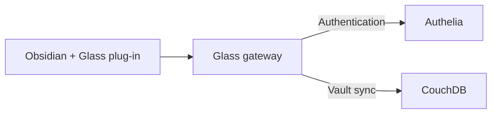

# Glass

SSO-enabled self-hosted livesync for obsidian

Glass adds Authelia sign-in and private, user-owned vaults to [Self-hosted LiveSync](https://github.com/vrtmrz/obsidian-livesync). It syncs local Obsidian vaults across Android and desktop.

## How it works



Users can create and sync their own private vaults. Sign in with Authelia, then create a vault or select one to download. Accounts are provisioned automatically.

## Setup

1. Configure the server image, URLs, and secrets using the [chart guide](charts/glass/README.md). Use an existing Authelia instance or bundle one with the chart.
2. Install the server:

   ```sh
   helm repo add authelia https://charts.authelia.com
   helm dependency build charts/glass
   helm upgrade --install glass charts/glass -f values.yaml
   ```

3. Install the Glass plug-in in your Obsidian vault and sign in. See [connecting devices](docs/connecting-devices.md).

[Development](docs/development.md) · [Upgrades](docs/upgrades.md) · [Backups](docs/backup-restore.md)

MIT. See [upstream attribution](UPSTREAM.md).
